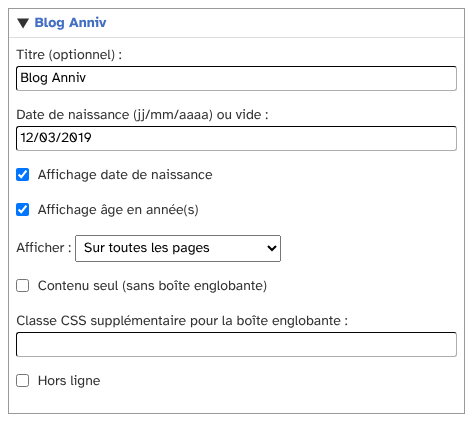
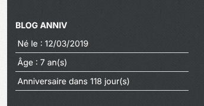

# Blog Anniv : guide d'utilisation

Ce guide explique comment afficher l'anniversaire de votre blog avec le widget _Blog Anniv_.

Ce plugin n'a pas de page d'administration. Il ajoute seulement un widget.

## Sommaire

* [À quoi sert le plugin](#à-quoi-sert-le-plugin)
* [Ajouter le widget](#ajouter-le-widget)
* [Régler le widget](#régler-le-widget)
* [Ce que le widget affiche](#ce-que-le-widget-affiche)
* [Changer le style](#changer-le-style)
* [Bon à savoir](#bon-à-savoir)

## À quoi sert le plugin

_Blog Anniv_ compte les jours avant le prochain anniversaire de votre blog.

Il peut aussi afficher la date de naissance du blog et son âge en années.

## Ajouter le widget

1. Allez dans _Blog_ puis _Widgets_.
2. Dans la liste des widgets disponibles, trouvez _Blog Anniv_.
3. Ajoutez-le au volet de votre choix (navigation, extra ou supplémentaire).
4. Cliquez sur _Enregistrer_ en bas de la page.

Vous pouvez aussi le glisser dans le volet avec la souris.

## Régler le widget

Cliquez sur le nom du widget pour ouvrir ses réglages.

* _Titre (optionnel)_ : le titre au-dessus de la liste. Laissez vide pour ne pas en mettre.
* _Date de naissance (jj/mm/aaaa) ou vide_ : la date de naissance du blog, avec des barres obliques (par exemple `12/03/2019`). Si vous laissez vide, le widget prend la date de création du blog.
* _Affichage date de naissance_ : montre ou cache la ligne « Né le ».
* _Affichage âge en année(s)_ : montre ou cache la ligne « Âge ».
* _Afficher_ : sur toutes les pages, ou seulement en page d'accueil.
* _Contenu seul (sans boîte englobante)_ : supprime la boîte autour du widget.
* _Classe CSS supplémentaire pour la boîte englobante_ : ajoute votre classe CSS.
* _Hors ligne_ : cache le widget sans le supprimer.

N'oubliez pas d'enregistrer.

## Ce que le widget affiche

Voici le widget sur le blog :

* _Né le_ : la date de naissance.
* _Âge_ : le nombre d'années écoulées.
* _Anniversaire dans_ : le nombre de jours avant le prochain anniversaire.

La ligne « Anniversaire dans » est toujours affichée. On ne peut pas la cacher dans les réglages.

## Changer le style

Chaque valeur est dans une balise avec sa propre classe CSS. Vous pouvez les modifier avec le plugin _moreCSS_ ou la feuille de style de votre thème.

* `annivne` : la date de naissance.
* `annivan` : l'âge.
* `annivjrs` : le nombre de jours.

Le widget lui-même porte la classe `bloganniv`, plus la classe que vous avez ajoutée.

## Bon à savoir

* Si la date est invalide (par exemple `31/02/2020`, `2020-05-01` ou un texte), le widget ne s'affiche pas du tout. Aucun message ne le signale. Vérifiez le format `jj/mm/aaaa`.
* Le jour de l'anniversaire, le compteur indique 0 jour et l'âge n'a pas encore augmenté. Il passe à l'âge suivant le lendemain.
* Pour une date de naissance dans le futur, l'âge est calculé comme si la date était dans le passé. Évitez-le.
* Un blog créé aujourd'hui affiche « Âge : 1 an » quand le champ date est vide.
